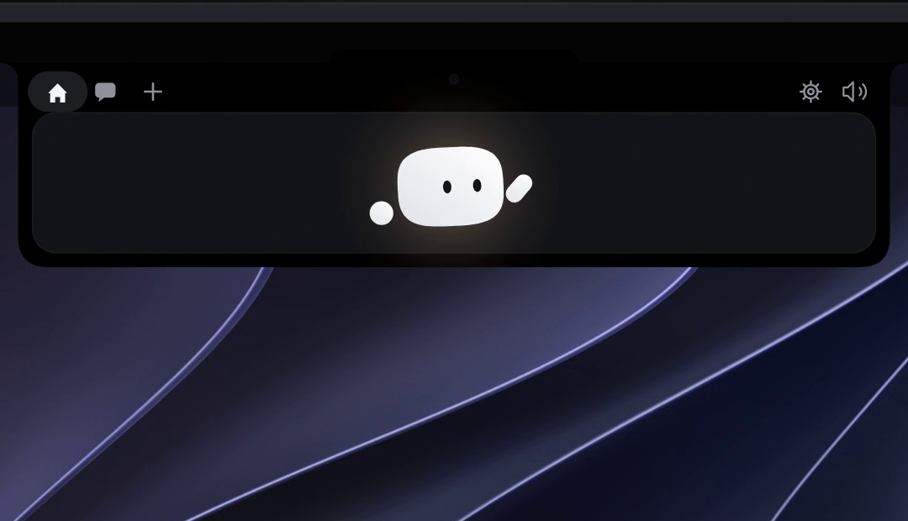

<div align="center">



# Powpow

**Um companheiro animado para seus agentes de código — morando na entalhadura do Mac ou no topo da tela do Windows.**

*Assista a cada sessão em tempo real, aprove permissões, solte arquivos, converse com o agente e escolha quem te acompanha — sem largar o que você estava fazendo.*


</div>

---

## 01 · Por que o Powpow existe

Agentes de código aprenderam a trabalhar sozinhos — mas ainda exigem companhia. Em qual terminal aquilo rodou? O que ele acabou de mudar? Está esperando por mim? Os testes passaram?

O Powpow responde essas perguntas de relance. Um pequeno amigo animado encostado na borda da tela mostra o que cada agente está fazendo e o que precisa de você — e deixa resolver tudo em um clique, sem trocar de janela, sem perder o fluxo.

## 02 · A ilha

**Muitos agentes, um mesmo lugar.** Claude Code, Gemini CLI, Antigravity (agy), OpenCode, Codex, Cursor e GitHub Copilot aparecem lado a lado: cada sessão ganha sua própria pílula, seus passos e sua pasta de trabalho. O Codex é acompanhado apenas lendo os logs dele — zero configuração; os demais entram por hooks ou por um plugin miúdo, instalados a partir das Configurações.

**Aprovações na borda.** Um pedido de permissão abre a ilha com **Negar / Sempre permitir / Permitir**. "Sempre" grava a escolha por ferramenta — a lista fica visível em *Configurações → Geral → Ferramentas liberadas* — para a mesma pergunta não voltar a incomodar. CLIs que só conversam (agy, Gemini antigo) recebem auto-aprovação estritamente de leitura, assim nunca ficam travados esperando um clique.

**Risco visível antes do clique.** Comandos destrutivos — apagar arquivos recursivamente, force-push, descartar alterações do git — chegam com um selo de risco em destaque no próprio cartão. Permitir deixa de ser um palpite.

**Atividade ao vivo.** Cada leitura, edição, comando e resultado de teste, passo a passo, no momento em que acontece.

**Histórico em palavras simples.** Quando o turno termina, a vista Histórica reconta o que houve: o que você pediu, os arquivos que mudaram, o que os testes disseram e o veredito — pronto para merge ou não — tudo em português claro, com um clique para copiar. O modo **Simples** fica curto; o modo **Detalhado** abre o resto.

**Diff ao vivo.** Enquanto o agente edita, o cartão de diff acompanha as linhas surgindo em tempo real, ao lado do resto da atividade.

> Se o Powpow estiver fechado, lento ou travado, o hook correspondente simplesmente desiste. **Uma sessão nunca é bloqueada nem atrasada por causa dele.**

## 03 · Conversa, arquivos e serviços

**Chat na ilha.** Pergunte qualquer coisa ao seu agente direto da borda. Provedores com suporte nativo: Anthropic (Claude) e Google Gemini. Acompanhe o consumo e limites de cota diretamente nas pílulas de uso (**Plano Claude**, **Plano Codex** e **Plano Gemini**). As chaves de API vivem de forma segura no Keychain do macOS ou no Credential Manager do Windows.

**Solte um arquivo.** Seu personagem vira uma caixa e engole o arquivo, pronto para você fazer perguntas ou pedir análises sobre ele.

**Anexe uma janela.** Arraste o companheiro sobre uma janela qualquer para acoplá-la como contexto da conversa.

**Integrações.** Spotify (música em reprodução sem chaves), WhatsApp Web (leitor de mensagens não lidas), Gmail, Outlook, Stripe, n8n, GitHub, Vercel, Resend, Notion e Cal.com — cada uma com sua pílula colorida e cartão de detalhes.

## 04 · Agente do Computador (Ações de Sistema)

O companheiro ganha superpoderes de um verdadeiro agente de sistema operacional no Windows, executando tarefas do dia a dia com segurança e APIs nativas:

* **Desktop Butler (Organizador de Pastas):**
  Analisa arquivos soltos na Área de Trabalho ou pasta Downloads e os organiza em subpastas inteligentes por categoria (Documentos, Imagens, Vídeos, Instaladores, Código, etc.). Exibe um cartão interativo com resumo e botão de **Desfazer** a qualquer momento.

* **Criador de Documentos Interativo:**
  Inicia a criação perguntando o que você precisa no chat da ilha, com botões para **Modelos Rápidos** (Planilha de Despesas & Finanças, Controle de Vendas & Estoque, Ata de Reunião, Documento de Notas) ou personalização livre por texto. Gera o arquivo no disco e abre imediatamente no aplicativo padrão do Windows.

* **Localizador de Arquivos:**
  Busca instantânea por termos, nomes ou extensões em Documentos, Downloads e Área de Trabalho, com filtros rápidos (PDFs, Planilhas, Documentos, Imagens) e botões diretos de **"Abrir"** e **"Ver na pasta"**.

* **Ghostwriter (Escrever no App Ativo):**
  Detecta a janela onde você estava trabalhando (Gmail no Chrome, Outlook, Word, Slack) e redige o e-mail ou texto ideal. Com 1 clique em **"Injetar no App Ativo"**, o Powpow restaura o foco da janela original (`SetForegroundWindow`) e insere o texto exatamente onde o cursor estiver posicionado.

* **Comandante do Windows:**
  Ajusta volume do sistema, ativa modo mudo, alterna tema Claro/Escuro diretamente no Registro do Windows, esvazia a lixeira e bloqueia o computador — tudo via comandos em linguagem natural ou atalhos.

* **Segurança & Win32 Puro:**
  Todas as ações de sistema usam chamadas diretas da API C do Windows (`user32`, `shell32`, Win32 Registry e Clipboard em memória Unicode). Zero processos ocultos de PowerShell e zero loops de teclado, eliminando falsos positivos de antivírus heurístico.

## 05 · O elenco e Companheiro de Tela

**Mochi**, o morador original da entalhadura, continua disponível. Ao lado dele: **Blu, Hop, Sunny, Lovi, Muse, Grok, Nova e Byte** — desenhados em SVG, com humores, olhos que acompanham o cursor e animações próprias para cada estado do agente.

**Monte o seu.** Em *Configurações → Personagem*, o construtor deixa escolher forma, olhos, topinho, cor e pelugem, com prévia ao vivo e botão de sorteio. "Usar este pal" grava a criação e ela passa a ser sua opção pessoal na lista de personagens.

**Mascote Andarilho & Assistente na Área de Trabalho (Roaming Pal):**
* **Perambulação Suave e Atenta:** O mascote caminha de forma relaxada pela tela, posicionando-se de forma inteligente ao lado do seu trabalho ativo para acompanhar sua rotina sem atrapalhar.
* **Popup Informativo de E-mail (Gmail e Outlook):** Ao chegar um novo e-mail, o mascote dá um salto alegre e exibe um card/popup informativo ao seu lado contendo o remetente, o assunto e o trecho real da mensagem de forma clara e elegante, sem poluição de áudio.
* **Alertas Visuais do WhatsApp:** Detecta mensagens recentes no WhatsApp Web e mostra no popup o nome de quem enviou (ex.: *"Marcos"*).
* **Lembretes e Agendamentos de Reuniões:** Mostra no popup quando um novo compromisso for marcado no Cal.com / agenda e exibe um lembrete visual 15 minutos antes da reunião começar.
* **Efeitos Visuais e Zero Áudio:** Alertas 100% visuais, com aura brilhante em expansão, estrelinhas flutuantes, poses de comemoração ou aceno, barra de progresso suave e botão de fechar — sem reproduzir áudio para não interromper seu foco ou músicas.
* **Deduplicação Inteligente & Zero Repetição:** Alertas nunca se repetem para itens já visualizados ou notificados anteriormente.

**Gestos.** Eles reagem o tempo todo — e os 28 sons do app acompanham cada evento, com opção de mudo quando o trabalho pede silêncio:

| Você faz | Ele faz |
|---|---|
| passa o mouse no topo da tela | espreita e cumprimenta |
| clica na ilha | abre a vista completa |
| clica no personagem | se irrita; três cliques seguidos e ele fica tonto |
| deixa o cursor parado dois segundos sobre ele | solta corações |
| arraste um arquivo até a ilha | vira uma caixa e engole o arquivo |
| arraste o personagem até uma janela | anexa a janela como contexto |
| `Esc` | fecha a ilha |

## 06 · Aparência e idioma

**Temas** — Onyx, Ice e Frost, mais a regra *Embasa*, que expande a ilha sobre fundos claros para o texto continuar legível.

**Português e inglês** — a interface existe nas duas versões e troca ao vivo em *Configurações → Idioma*, sem reiniciar nada.

## 07 · Privacidade

- Sem telemetria e sem conta. O app não reporta nada a lugar nenhum.
- Chaves de API e de integração vivem no Keychain (macOS) ou no Credential Manager (Windows) — nunca em disco, nunca na interface.
- A única rede que o Powpow faz é para os serviços que **você** configurou.
- Sempre que os hooks do Claude Code precisam ser alterados, você recebe o diff exato, um backup datado e só então decide gravar. Nada é escrito sem o seu clique, e apenas as entradas do Powpow são tocadas.
- O log de depuração fica na sua máquina (`%LOCALAPPDATA%\Powpow\powpow.log` no Windows) e não guarda comandos nem URLs completas.

## 08 · Instalação

### macOS

1. Baixe o `Powpow.zip` mais recente em [Releases](https://github.com/corefusiion/powpow/releases).
2. Descompacte e mova o **Powpow.app** para `/Applications`.
3. Na primeira abertura, se o macOS não reconhecer o desenvolvedor: *Ajustes do Sistema → Privacidade e Segurança → Abrir mesmo assim* (uma vez).

### Windows

Não há entalhadura num PC, então a ilha escorrega do topo da tela. Baixe o instalador ou a versão portátil no artefato mais recente do [workflow do Windows](https://github.com/corefusiion/powpow/actions/workflows/windows.yml) — os artefatos ficam disponíveis por 3 dias — ou [compile você mesmo](#09--compilando-a-partir-do-código), são poucos minutos e não pede administrador. O detalhe de cada caminho está em [`windows/README.md`](windows/README.md), inclusive a nota sobre o falso positivo do Microsoft Defender no instalador ainda sem assinatura.

### Pela linha de comando

O mesmo código roda em qualquer sistema como pal flutuante + dashboard local:

```bash
git clone https://github.com/corefusiion/powpow.git
cd powpow
npm install
npm run setup        # assistente: instala, conecta seus agentes e abre tudo
```

Sem clonar, uma linha faz o mesmo:

```bash
npx --allow-git=all github:corefusiion/powpow setup
```

Depois do setup:

```bash
npm run dashboard    # http://127.0.0.1:5175/dashboard
npm run float        # o pal flutuante (Electron)
npm run bridge       # só a ponte, sem janela
```

## 09 · Compilando a partir do código

**macOS** — requer macOS 15+, Xcode 16+ e [XcodeGen](https://github.com/yonaskolb/XcodeGen):

```bash
brew install xcodegen
git clone https://github.com/corefusiion/powpow.git
cd powpow/NotchBuddy
xcodegen
open NotchBuddy.xcodeproj    # depois é só ⌘R
```

O projeto nunca é editado à mão: mexa em `project.yml` e rode o `xcodegen` de novo.

**Windows** — requer [Rust](https://rustup.rs), Node 20+ e as ferramentas MSVC ("Desenvolvimento de desktop com C++"):

```powershell
git clone https://github.com/corefusiion/powpow.git
cd powpow/windows
npm install
npm run tauri dev      # desenvolvimento com recarga ao vivo
npm run pack           # instalador em windows/release/
```

**Ponte e testes** — requer Node 20+:

```bash
npm install
npm test               # suíte de testes (node --test)
npm run bridge         # http://127.0.0.1:5175/dashboard
```

## 10 · Configuração

Abra as Configurações pela barra de menu (macOS) ou pela bandeja (Windows):

| O que conectar | Para quê | Onde |
|---|---|---|
| **Hooks do Claude Code** | sessões ao vivo e aprovações | *Claude Code → Instalar hooks.* — o Powpow mostra o diff exato e o backup datado antes de escrever qualquer coisa |
| **Hooks do Gemini CLI / Antigravity** | as sessões deles na ilha | um clique em cada, sempre com backup antes |
| **Plugin do OpenCode** | as sessões dele na ilha | copie o plugin para `~/.config/opencode/plugins/` |
| **Chave de API** (Claude / Gemini) | chat pela ilha | Keychain ou Credential Manager |
| **Integrações** | as pílulas | Keychain ou Credential Manager — tudo opcional |

Se o Powpow não estiver no ar, os hooks saem imediatamente: **seu agente nunca fica esperando por ele.**

## 11 · Como funciona

**Windows** — um app [Tauri 2](https://tauri.app): a ilha é uma janela transparente, sempre por cima, que nunca rouba o foco. Os CLIs de agente conversam com o app por um relé minúsculo (`powpow-hook.exe`) via named pipe; os pedidos de permissão esperam o seu clique e só então respondem ao hook — com limite de 300 ms para chegar lá. As chaves ficam no Credential Manager.

**macOS** — um `NSPanel` sem bordas encostado na entalhadura; o personagem é desenhado em SwiftUI `Canvas` + `TimelineView`, a 60 fps, sem imagens nem bibliotecas de animação. Um relé por socket encaminha os eventos; as aprovações ficam bloqueadas até você clicar.

**Ponte de atividade** (plataforma independente) — adaptadores de hook para cada agente mandam eventos para uma ponte local, que mescla tudo num único log de atividade e retransmite por Server-Sent Events. Qualquer interface — dashboard, um `<dot-pal>` embutido, o script do seu time — consome o mesmo fluxo:

```js
const pal = document.querySelector('dot-pal');
const source = new EventSource('http://127.0.0.1:5175/events');
source.onmessage = (e) => {
  const { state, text } = JSON.parse(e.data);
  pal.setState(state, { text });   // repassa o estado ao personagem
};
```

O componente `<dot-pal>` também anda sozinho, sem build e sem dependências:

```html
<script type="module" src="https://cdn.jsdelivr.net/npm/powpow"></script>
<dot-pal character="sunny"></dot-pal>
```

Veja [`bridge/`](bridge/) e [`src/`](src/) para os adaptadores e a API completa do componente.

## 12 · Estrutura do repositório

| Onde | O que tem |
|---|---|
| [`windows/`](windows/) | o companheiro Windows — app [Tauri 2](https://tauri.app) (Rust + TypeScript): janela-ilha, motor do personagem, hooks, aprovações, chat, integrações |
| [`NotchBuddy/`](NotchBuddy/) | o companheiro macOS — Swift 6 nativo com SwiftUI e AppKit, sem nenhuma dependência de terceiros |
| [`bridge/`](bridge/) | ponte de atividade local (Node, zero dependências em runtime): adaptadores para cada agente, log unificado, fluxo HTTP + SSE em `127.0.0.1:5175`, histórico, guarda de conflito entre agentes e handoff |
| [`src/`](src/) | `<dot-pal>` — componente web animado e sem dependências: personagens, humores, estados de agente e o construtor de pals. Funciona em qualquer página, sem build |
| [`hooks/`](hooks/), [`commands/`](commands/), [`.claude-plugin/`](.claude-plugin/) | plugin do Claude Code: hooks e comandos de barra |
| [`desktop/`](desktop/) | o pal flutuante em Electron e o launcher do dashboard (`npm run float`) |
| [`docs/`](docs/) | site, especificação (`SPEC.md`) e documentação de integrações |
| [`design/`](design/) | protótipo HTML — a fonte da verdade visual — e as capturas de referência |
| [`test/`](test/), [`tests/`](tests/) | suíte Node (`node --test`) e testes Swift (geometria da tela, links seguros) |
| [`scripts/`](scripts/), [`bin/`](bin/) | utilitários de desenvolvimento e a CLI `powpow` |

## 13 · Estrada aberta

- Ilha consumindo direto o feed SSE unificado da ponte
- Mais provedores de chat — OpenRouter, OpenAI e outros
- Mais personagens e mais personalização dentro da ilha
- Mais agentes cobertos à medida que ganharem suporte a hooks

## 14 · Contribuindo

Issues e pull requests são muito bem-vindos: novos adaptadores, personagens, sons, provedores e correções de bugs. O guia está em [CONTRIBUTING.md](CONTRIBUTING.md) — inclui os primeiros passos e boas contribuições para começar.

## 15 · Licença

- **Código:** [MIT](LICENSE) — use, faça fork, aprenda; é só manter os avisos de copyright.
- **Ponte e componente web:** MIT — ver [LICENSE-dotpals](LICENSE-dotpals) e [THIRD_PARTY_NOTICES](THIRD_PARTY_NOTICES) para o código de terceiros adaptado.
- **Arte e sons:** ver [LICENSE-ASSETS.md](LICENSE-ASSETS.md).

Mantido por [Gleisson Santos](mailto:jsgleisson@gmail.com).

<div align="center">

**Se o Powpow deixou seu terminal mais agradável, uma estrela no repositório ajuda a espalhar a palavra.**

[Issues](https://github.com/corefusiion/powpow/issues)

</div>
